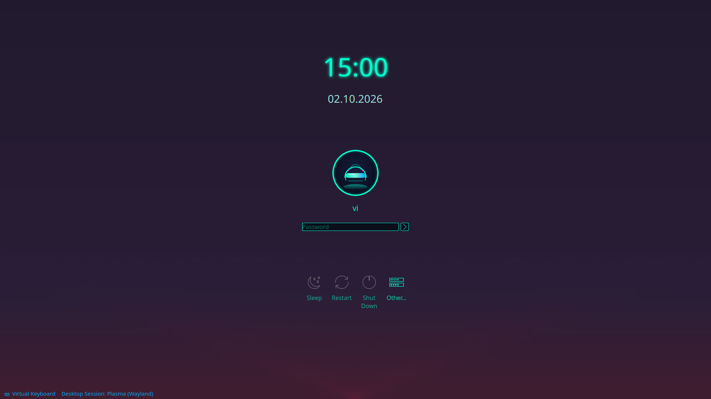

# Cyberpunk — neon SDDM login theme (Qt6)

A synthwave/cyberpunk theme for the [SDDM](https://github.com/sddm/sddm) display
manager: dark navy→plum gradient with a magenta grid, glowing cyan clock,
anonymous-mask avatar, dark input fields with cyan focus rings and magenta
hovers, and a blue→cyan footer.



## Features

- Fully **explicit** neon color scheme — never inherits the light Breeze palette
- Glowing clock + date in JetBrains Mono style
- Synthwave gradient wallpaper (bundled, relative paths only)
- Anonymous mask as the default avatar (`faces/.face.icon`)
- Dark password field: cyan focus border, magenta hover on the `>` button
- Footer (Virtual Keyboard / session / battery): secondary blue → cyan on hover
- Power actions (Sleep / Restart / Shut Down / Other…) in neon
- Virtual keyboard support (Qt6 greeter, X11 and Wayland sessions)
- Single self-contained directory — no post-install scripts inside the theme

## Requirements

- **SDDM built with Qt 6** — the theme declares `QtVersion=6`
  - check: `command -v sddm-greeter-qt6` (Debian/Ubuntu) or `sddm --version` shows Qt 6
  - ✅ Ubuntu 24.10+ / 25.04 / 26.04, KDE neon, Arch, Fedora, openSUSE Tumbleweed
  - ❌ stock Ubuntu 24.04 (SDDM/Qt5 greeter)
- The session list (Wayland/X11) comes from your system — the theme just displays it

## Install

```bash
git clone https://github.com/valeksan/sddm-theme-cyberpunk.git
cd sddm-theme-cyberpunk
sudo ./install.sh
```

What it does:

1. backs up any existing `/usr/share/sddm/themes/Cyberpunk` to `Cyberpunk.bak-<date>`
2. copies `theme/` there
3. writes `/etc/sddm.conf.d/zz-cyberpunk.conf` with `Current=Cyberpunk`
   (`zz-` sorts last, and SDDM merges `sddm.conf.d` alphabetically with later
   files winning — verified on Ubuntu 24.04 and 26.04)

Apply:

```bash
sudo systemctl restart sddm
```

> ⚠️ `restart sddm` **ends the current graphical session** — log out first,
> or do it from a TTY.

### Manual install

```bash
sudo cp -r theme /usr/share/sddm/themes/Cyberpunk
printf '[Theme]\nCurrent=Cyberpunk\n' | sudo tee /etc/sddm.conf.d/zz-cyberpunk.conf
sudo systemctl restart sddm
```

## Uninstall

```bash
sudo ./uninstall.sh
```

Removes the theme directory and `zz-cyberpunk.conf`; timestamped backups
(`Cyberpunk.bak-*`) are kept.

## Configuration

`/usr/share/sddm/themes/Cyberpunk/theme.conf`:

| Key | Meaning |
|---|---|
| `background` | wallpaper file name **inside the theme dir** (bundled: `background.png`) |
| `type` | `image` (show `background`) or `color` (show `color`) |
| `color` | fallback/accent color (`#00ffcc`) |
| `fontSize` | base font size for the greeter texts |
| `showlogo` / `logo` | top-left logo: `hidden`/`shown` + logo file in the theme dir |

**Swap the wallpaper:** drop your image into the theme directory and point
`background=` at its file name — paths are resolved inside the theme dir, so
nothing outside the theme is referenced:

```bash
sudo cp my-wall.png /usr/share/sddm/themes/Cyberpunk/background.png
# (or edit theme.conf and set background=my-wall.png)
```

### Anonymous avatar for your account

The theme falls back to the bundled mask (`faces/.face.icon`) when an account
has no avatar. To force the mask for your account even if a photo is set:

```bash
sudo cp /usr/share/sddm/themes/Cyberpunk/faces/.face.icon /var/lib/AccountsService/icons/$USER
sudo chown root:root /var/lib/AccountsService/icons/$USER
sudo chmod 644 /var/lib/AccountsService/icons/$USER
```

(The login screen reads avatars from AccountsService, **not** from `~/.face.icon`.)

## Troubleshooting

- **Theme does not change after restart** — another file in
  `/etc/sddm.conf.d/*.conf` overrides yours; find the winner with
  `strace -f -e openat sddm --test-mode 2>&1 | grep sddm.conf.d`
  (keep `zz-cyberpunk.conf`, it sorts last).
- **Black screen / "Fallback to embedded theme"** — check
  `journalctl -b | grep -i sddm` for QML errors; make sure your SDDM is Qt 6.
- **Keyboard layout missing** — SDDM needs `keyboard-layout` configured in
  `/etc/sddm.conf`; the theme only renders it.

## Provenance & credits

Built on KDE's SDDM **Breeze** theme and its Kubuntu branding variant.
Original QML copyright/license headers are preserved verbatim (SPDX) —
notably David Edmundson, Aleix Pol Gonzalez, Martin Gräßlin,
Boudhayan Gupta, ivan (@ratijas) tkachenko, Scarlett Moore and the
KDE Visual Design Group. See [NOTICE](NOTICE).

Qt6 port, neon restyle, wallpaper and packaging: **valeksan** (2026).

## License

[GPL-2.0-or-later](LICENSE). Third-party files keep their SPDX headers
(LGPL-2.0-or-later / GPL-2.0-or-later / KDE-Accepted-LGPL) and remain under
those terms.
